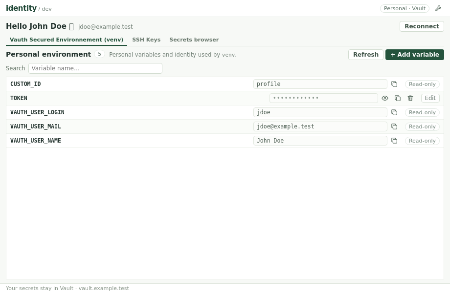
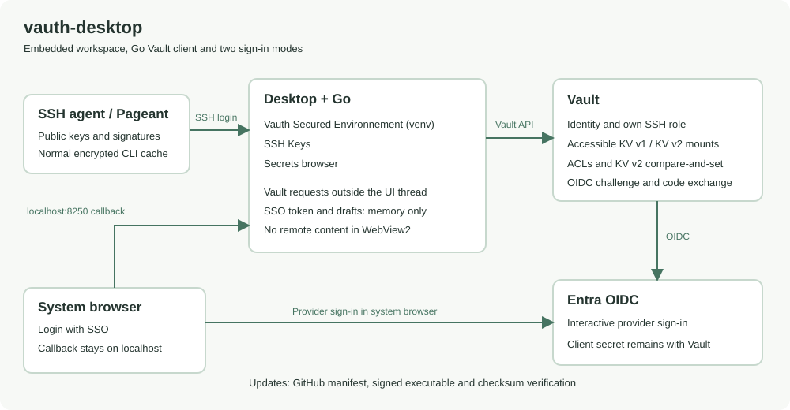

# vauth-desktop

## Your personal Vault space, one click from the tray

A small Windows app for your personal [Vault](https://developer.hashicorp.com/vault/docs)
space: your environment, Vault secrets and SSH keys. It signs you in with your
SSH agent (Pageant or ssh-agent), like [vauth](https://github.com/131/vauth-login):
no browser, no password.

## How it works

## Install

Download `vauth-desktop-windows-amd64.exe` from the
[latest release](https://github.com/131/vauth-desktop/releases/latest), put it
wherever you like and run it. One signed file, nothing to install.

If your SSH key is not enrolled yet, use **Login with SSO** and publish a public
key from **SSH Keys**. SSO needs the configured Vault/Entra callback and keeps
its Vault token only in memory; it does not populate the CLI token cache.

## What you can do

- **Vauth Secured Environnement (venv)**: search personal variables and your
  read-only identity in one list. Add, edit, copy and delete personal variables.
- **SSH Keys**: select an agent key or paste a public key, then publish it to
  your own Vault role. After SSO enrollment, continue with the normal SSH login.
- **Secrets browser**: navigate accessible KV stores, reveal/copy values and
  create, edit or delete documents according to your Vault permissions. KV v2
  writes use compare-and-set; KV v1 has no equivalent protection.

Secret values stay hidden until revealed. Changes use explicit dialogs; display
fields remain read-only. The workspace image uses synthetic demonstration data.

The app lives in the notification area: closing the window keeps it there,
click the icon to bring it back, right-click > Quit to exit.

## Updates

vauth-desktop updates itself: when a new version is out, a notification offers
to install it. Only versions signed by the same publisher are accepted.
Choose the release channel (`production` by default) and check for updates
from the settings (wrench, top right).

## Settings

Language and release channel are set from the app. Everything else lives in
`%APPDATA%\vauth-desktop\settings.yml`: see [settings](specs/SETTINGS.md).

Your Vault address and sign-in method come from your usual `.vauthrc`, as for
vauth: see [vauth-login](https://github.com/131/vauth-login#configuration).

## Security

Whoever uses your SSH agent can sign in as you: lock your session. Secrets are
only kept in memory while the app runs.

## Specifications

[Settings](specs/SETTINGS.md), [releases and auto-update](specs/RELEASES.md),
[Vault access](specs/VAULT.md), [development](specs/DEVELOPMENT.md).

[Workspace](specs/WORKSPACE.md), [authentication and first enrollment](specs/AUTHENTICATION.md).
Version 2.0.0 introduces the workspace and SSO enrollment flow.
Live Windows SSO/enrollment validation remains operator-confirmed.

## Credits

- [131](https://github.com/131)
- [OpenAI](https://openai.com) Codex, in collaboration
- [vauth-login](https://github.com/131/vauth-login) and
  [ssh-agent-crypt](https://github.com/131/ssh-agent-crypt): Vault login and
  token cache
- [go-webview2](https://github.com/jchv/go-webview2): WebView2 window without cgo
- Code signing, courtesy of Essilor International

vauth-desktop is not affiliated with HashiCorp: see [CREDITS.md](CREDITS.md)
for trademarks.

ISC license.
