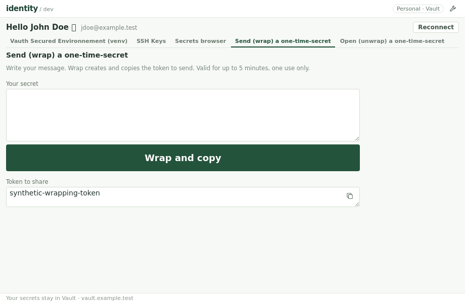
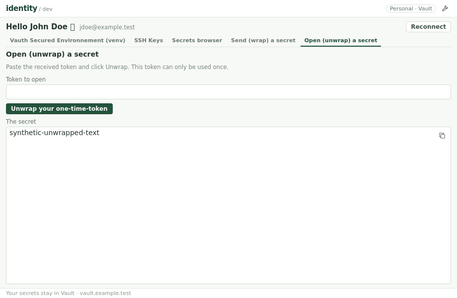
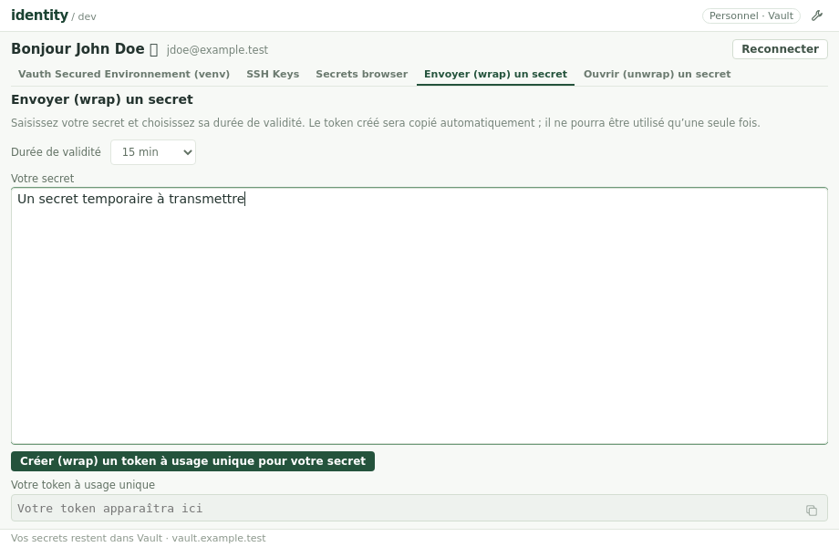
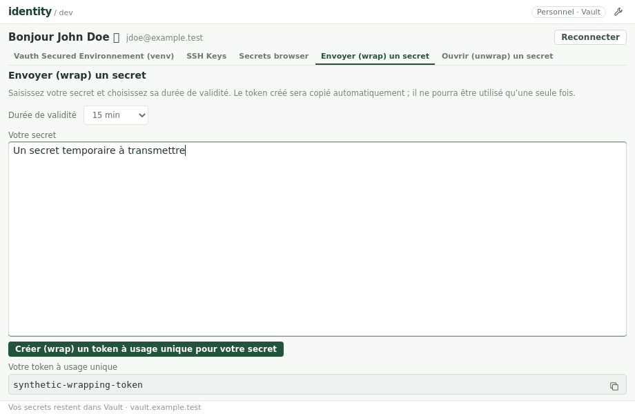
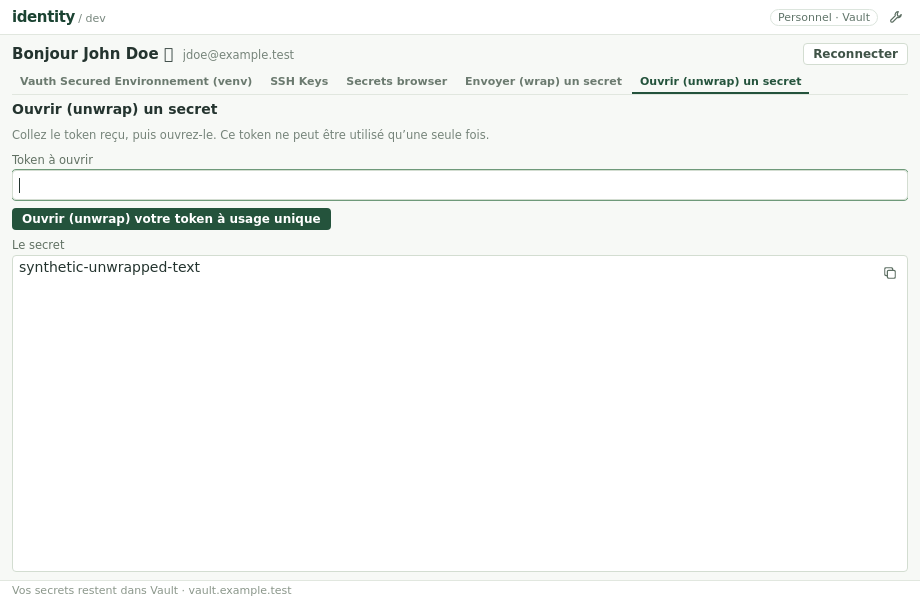
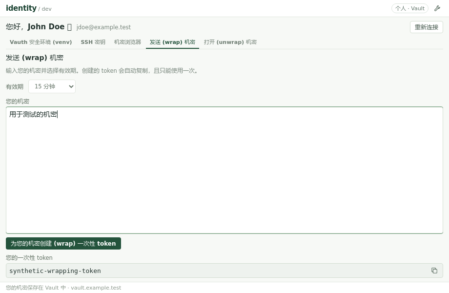
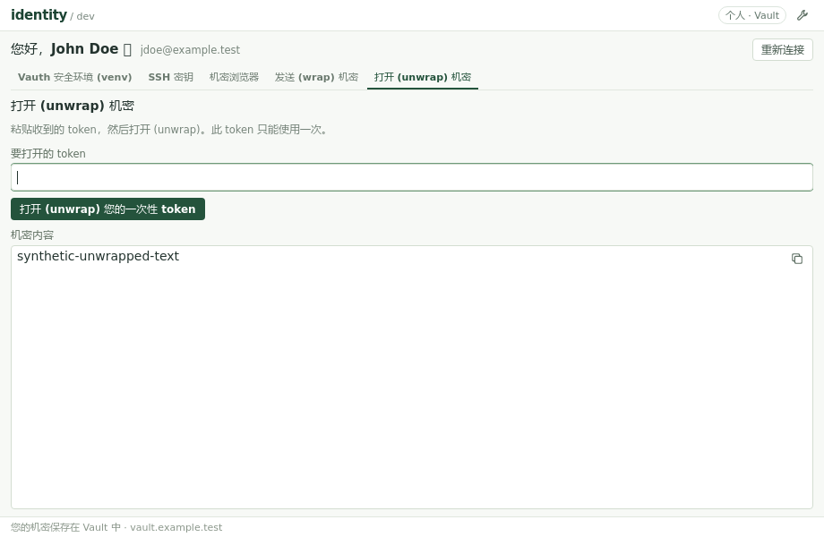

# One-time secret sharing

## Two tabs, one action each

**Send (wrap) a secret** and **Open (unwrap) a secret** are separate workspace
tabs, after the secrets browser. These canonical en-us labels have natural fr-fr equivalents for the tabs and
headings; see [Language & terminology](#language--terminology). Navigation wraps at narrow window widths.
The interface and RPC contract deal only in text and tokens, not JSON documents.

- **Send (wrap) a secret**: write any nonblank text secret and click **Wrap your secret into a one-time-token**. The app creates
  a single-use Vault token, displays it and copies it to the clipboard. Send
  that token to the recipient. The lifetime dropdown offers **15 min** (default),
  **6 h** and **72 h**. Vault policies remain authoritative and can refuse a
  selected lifetime. There is no JSON format selector.
- **Open (unwrap) a secret**: paste the received token and click **Unwrap your one-time-token**. Display the original
  secret directly as read-only text, with a copy icon. No JSON response,
  metadata or additional reveal action is shown. The token is consumed by this
  action; it cannot be used again.
- The generated token area is always reserved. Its empty read-only input is
  grayed out and disabled, as is its copy action. Successful wrapping fills and
  enables it without shifting the textarea or button. The secret draft stays
  in the textarea after wrapping, including if clipboard copying fails.
- Token input/output are single-line text fields. The secret to send and the
  recovered secret use textareas, with recovered text read-only.
- The TTL dropdown precedes the send textarea. Both textareas grow with the
  window in both dimensions instead of remaining fixed-size/manual-resize.
  The en-us input label is **Token to open**, and the output label is
  **Your one-time-token**; fr-fr uses the translated terms below.
- Both forms have one compact primary button. Output copy icons allow copying
  again without issuing or consuming another token. A clipboard failure after
  wrapping retains the issued token for manual copying.
- Failed requests preserve the input and a previously issued wrapping token.
  A new unwrap attempt clears the previous secret even if it fails. Success
  clears the submitted unwrap token unless it was edited during the request;
  wrapping never clears the secret draft.
- Reconnect, session clearing and window destruction discard both forms and
  outputs. Replies from a previous session cannot repopulate the new session.
  Tokens/secrets are not written to settings, logs or WebView storage.
  Clipboard contents are not cleared when the window closes.

Anyone holding the token can read the message once before expiry. This uses
Vault response wrapping, not local encryption or a permanent secret store.
No KV document is read or created and no ACL or authentication policy changes.
The application authentication token stays in Go; only the deliberate wrapping
input/output token enters the page and clipboard.

## Language & terminology

The operator-provided **en-us wording is canonical**, not a fallback to render
in French. `fr-fr` and `zh-cn` translate the intent into natural French rather than copying
English labels or mechanically transliterating Vault operations.

| en-us | fr-fr | zh-cn |
| --- | --- | --- |
| Send (wrap) a secret | Envoyer (wrap) un secret | 发送 (wrap) 机密 |
| Open (unwrap) a secret | Ouvrir (unwrap) un secret | 打开 (unwrap) 机密 |
| Wrap your secret into a one-time-token | Créer (wrap) un token à usage unique pour votre secret | 为您的机密创建 (wrap) 一次性 token |
| Unwrap your one-time-token | Ouvrir (unwrap) votre token à usage unique | 打开 (unwrap) 您的一次性 token |
| Your one-time-token | Votre token à usage unique | 您的一次性 token |
| Token to open | Token à ouvrir | 要打开的 token |
| Your secret | Votre secret | 您的机密 |
| The secret | Le secret | 机密内容 |
| Valid for | Durée de validité | 有效期 |
| Copy secret | Copier le secret | 复制机密 |

When a control names the secret-sharing operation, place its technical hint
immediately after the localized action: **Send (wrap)** / **Envoyer (wrap)**,
and **Open (unwrap)** / **Ouvrir (unwrap)**. Token-creation labels similarly
use **Create (wrap)** / **Créer (wrap)**. In zh-cn the corresponding verbs are
**发送 (wrap)**, **打开 (unwrap)** and **创建 (wrap)**. Apply this to tabs, headings and
buttons using those verbs, followed by the relevant object. `Wrap`/`Unwrap`
actions already name the operation and need no duplicate hint. Instructions
about actually sending the copied token to a recipient are not another wrap
operation and do not acquire a misleading `(wrap)` suffix.

Use **secret**, not "message", for the user's text throughout labels, help,
notifications and errors. In en-us, **one-time-token** is the canonical label;
"token" is acceptable in surrounding explanations where its purpose is clear.
In fr-fr, keep **token** unchanged and use **token à usage unique** when the
single-use meaning must be explicit. Translate the surrounding actions and explanations; do not copy English action sentences into
French controls. In zh-cn, retain **token**, using **一次性 token** for a
one-time-token, and localize actions/help/errors into Simplified Chinese. Preserve the operator-selected technical hints `(wrap)` and
`(unwrap)` in the French tab names and headings; keep technical API names
unchanged in code/documentation.

The shareable one-time-token is distinct from the application's Vault session
token, which never enters the page. Do not describe the wrapping token as an
encrypted copy of the secret: it grants a single retrieval from Vault.

The visible catalog lives in `internal/i18n/messages.json`. Every new field,
placeholder, copy action, status and error has all three locales; tests cover the
canonical actions and their French/Chinese equivalents. This convention is scoped to
secret sharing and does not rename other operator-selected workspace labels.

## Text-only API

- `wrap(text, ttlSeconds) -> token`: reject blank text, send `POST sys/wrapping/wrap` with
  the internal JSON object `{"value": text}` and `X-Vault-Wrap-TTL` set to 900, 21600 or 259200 seconds. Text,
  including whitespace, Unicode and JSON-like content, is preserved exactly.
  Use the session's normal authentication and return only the wrapping token.
- `unwrap(token) -> text`: trim/reject blank tokens, send one
  `POST sys/wrapping/unwrap` with the wrapping token only in `X-Vault-Token`.
  Do not put it in a JSON body, renew the desktop session, retry the one-use
  request or replace the application's session token. Extract only the string
  `data.value`; incompatible payloads fail explicitly after consumption.
- JSON encoding/decoding and Vault metadata are private to Go. Go rejects
  lifetimes outside the three supported dropdown values before any request.
  SDK destination trust, transport, timeout and redirect policy are preserved.
  HTTP errors do not expose server response bodies.

Sources: HashiCorp [wrap](https://developer.hashicorp.com/vault/api-docs/system/wrapping-wrap)
and [unwrap](https://developer.hashicorp.com/vault/api-docs/system/wrapping-unwrap) APIs.

## Verification

Mock Go tests cover exact text/envelope/headers, all three TTL choices and invalid TTLs, blank/wrong input,
malformed or incompatible responses, HTTP/network failures, one use, no retry,
no session mutation and redirect policy. Browser tests cover the separate tabs,
text/TTL RPCs, automatic token copying, direct text output, retained drafts,
reserved token geometry before/after wrapping, translated terminology,
copying names independently of secret values, and reconnect clearing.
No real Vault data or secrets are used by these tests. Native Windows usage
and live secret sharing remain operator validation.
