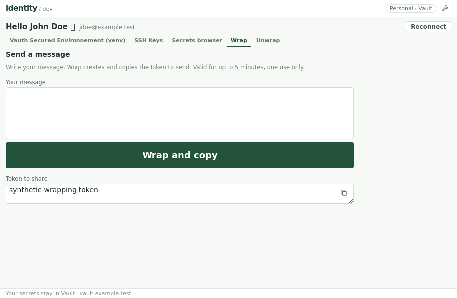
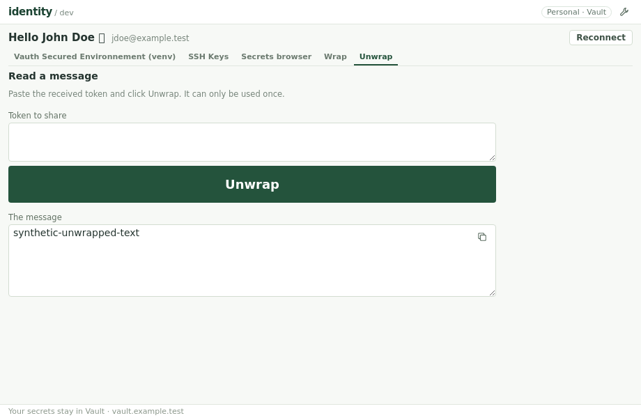

# Share a text message

## Two tabs, one action each

**Wrap** and **Unwrap** are separate workspace tabs, after the secrets browser.
The interface and RPC contract deal only in text and tokens, not JSON documents.

- **Wrap**: write any nonblank message and click **Wrap and copy**. The app creates
  a single-use Vault token, displays it and copies it to the clipboard. Send
  that token to the recipient. Validity is fixed at five minutes maximum; Vault
  limits remain authoritative. There is no format or duration selector.
- **Unwrap**: paste the received token and click **Unwrap**. Display the original
  message directly as read-only text, with a copy icon. No JSON response,
  metadata or additional reveal action is shown. The token is consumed by this
  action; it cannot be used again.
- Both forms have one large primary button. Output copy icons allow copying
  again without issuing or consuming another token. A clipboard failure after
  wrapping retains the issued token for manual copying.
- Failed requests preserve the input and a previously issued wrapping token.
  A new unwrap attempt clears the previous message even if it fails. Success
  clears the submitted input unless it was edited during the request.
- Reconnect, session clearing and window destruction discard both forms and
  outputs. Replies from a previous session cannot repopulate the new session.
  Tokens/messages are not written to settings, logs or WebView storage.
  Clipboard contents are not cleared when the window closes.

Anyone holding the token can read the message once before expiry. This uses
Vault response wrapping, not local encryption or a permanent secret store.
No KV document is read or created and no ACL or authentication policy changes.
The application authentication token stays in Go; only the deliberate wrapping
input/output token enters the page and clipboard.

## Text-only API

- `wrap(text) -> token`: reject blank text, send `POST sys/wrapping/wrap` with
  the internal JSON object `{"value": text}` and `X-Vault-Wrap-TTL: 300`. Text,
  including whitespace, Unicode and JSON-like content, is preserved exactly.
  Use the session's normal authentication and return only the wrapping token.
- `unwrap(token) -> text`: trim/reject blank tokens, send one
  `POST sys/wrapping/unwrap` with the wrapping token only in `X-Vault-Token`.
  Do not put it in a JSON body, renew the desktop session, retry the one-use
  request or replace the application's session token. Extract only the string
  `data.value`; incompatible payloads fail explicitly after consumption.
- JSON encoding/decoding, the fixed TTL and Vault metadata are private to Go.
  SDK destination trust, transport, timeout and redirect policy are preserved.
  HTTP errors do not expose server response bodies.

Sources: HashiCorp [wrap](https://developer.hashicorp.com/vault/api-docs/system/wrapping-wrap)
and [unwrap](https://developer.hashicorp.com/vault/api-docs/system/wrapping-unwrap) APIs.

## Verification

Mock Go tests cover exact text/envelope/headers, fixed TTL, blank/wrong input,
malformed or incompatible responses, HTTP/network failures, one use, no retry,
no session mutation and redirect policy. Browser tests cover the separate tabs,
string-only RPCs, automatic token copying, direct text output, failed drafts,
copying names independently of secret values, and reconnect clearing.
No real Vault data or messages are used by these tests. Native Windows usage
and live message exchange remain operator validation.
